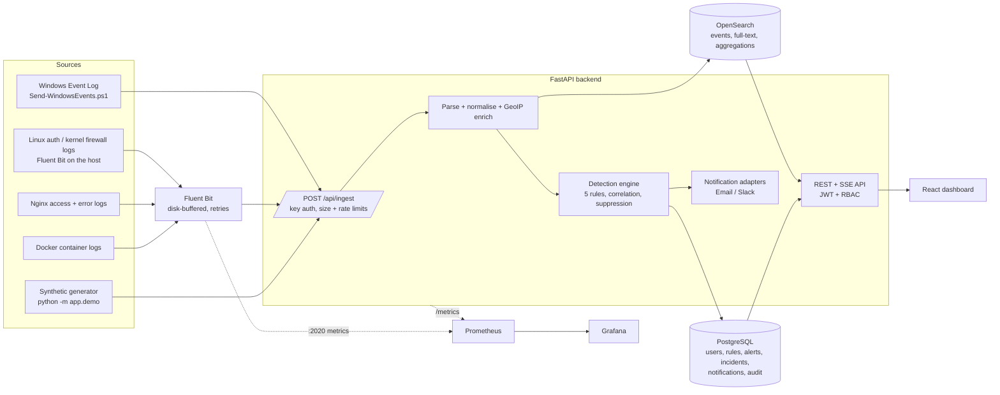

# Architecture

## Data flow

## Components

| Component | Responsibility | Code |
|---|---|---|
| Ingestion API | Key auth, body/batch limits, rate limiting, JSON validation, processes in slices of 500 | `backend/app/routers/events.py`, `deps.py` |
| Normaliser | Windows (EventData and positional `StringInserts`), Linux auth/sudo, kernel firewall, Nginx access/error, Docker JSON, generic JSON → one schema; UTC timestamps; deterministic `event_id` | `backend/app/ingest/normalize.py` |
| Enrichment | GeoIP (MaxMind `.mmdb` or static CIDR file); private/reserved/unknown IPs are labelled, never given coordinates | `backend/app/ingest/geo.py` |
| Event store | `OpenSearchStore` (production) and `MemoryStore` (tests / OpenSearch-less dev) behind one interface; versioned index template, daily indices, ISM retention policy | `backend/app/store.py` |
| Detection | Rule classes + engine; findings become de-duplicated alerts | `backend/app/detection/` |
| Notifications | Email (SMTP) and Slack webhook adapters, severity routing, retries, once-per-alert delivery rows | `backend/app/services/notify.py` |
| Auth / RBAC | Argon2id passwords, JWT access + refresh tokens, role read from DB on every request | `backend/app/security.py`, `deps.py` |
| Reports | CSV (formula-injection safe) and PDF (ReportLab), 5 000-row cap, audited | `backend/app/routers/reports.py` |
| Metrics | Prometheus counters/histograms with bounded labels | `backend/app/metrics.py` |
| Frontend | React + TypeScript + Vite + Tailwind + Recharts, typed API client with token refresh | `frontend/src/` |

## Why two datastores

* **OpenSearch** holds the high-volume, append-only event stream: full-text search, aggregations, time-based indices and
  retention. PostgreSQL would be the wrong tool for that workload and events are not duplicated there.
* **PostgreSQL** holds small relational state that needs transactions and constraints: users, rules/config, alerts,
  incidents + notes + history, notification deliveries and the audit log. Alerts reference events by `event_id`
  (evidence is looked up in OpenSearch on demand).

## Event schema (OpenSearch mapping `siem-events-*`, template version 1)

`event_id`, `@timestamp` (UTC), `host`, `source_type`, `category`, `action`, `outcome`, `severity`, `user`, `src_ip`,
`dst_ip`, `src_port`, `dst_port`, `process_name`, `command_line`, `file_hash`, `domain`, `message`, `raw` (truncated to
4 KiB), `fields` (stored, not indexed), `geo`, `synthetic`, `detections` (rule IDs that referenced the event).
The mapping is `dynamic: false`, so hostile logs cannot create unbounded fields.

## Detection engine

For every ingested batch the engine selects the enabled rules that have at least one *relevant* event in the batch, then
evaluates each rule **as of its newest relevant event** (so back-dated or replayed batches correlate correctly).

* `Rule.evaluate(store, ref_time, config)` fetches the rule's window from the store (bounded to 5 000 events) and returns
  `Finding`s (correlation key, severity, first/last seen, counters, event IDs, evidence).
* `upsert_alert` implements **suppression**: if an open/acknowledged alert with the same correlation key was last seen
  within `suppression_seconds`, the existing alert is updated (counter, last seen, event IDs, repeat counter, severity
  escalation). A resolved alert allows a new one.
* Events that contributed get the rule ID appended in `detections`.

| Rule | Key | Default | MITRE |
|---|---|---|---|
| SIEM-001 Brute-force | source IP | ≥5 SSH/app failures (incl. HTTP 401/403) in 120 s | T1110 |
| SIEM-002 Multiple failed logins | host + account | ≥5 failures in 600 s (Windows, Linux, app) | T1110 |
| SIEM-003 Port scan | source → target | ≥15 distinct destination ports in 60 s | T1046 |
| SIEM-004 Suspicious command | host + user + pattern | 7 regex patterns on command lines | T1059 |
| SIEM-005 Malware indicators | host | hash / domain / IP / process-name matches | none claimed |

SIEM-005 deliberately claims **no** ATT&CK technique: an indicator match does not by itself tell us which technique was
used. The MITRE page lists such rules as "unmapped" instead of inflating coverage.

### Telemetry prerequisites (what the rules cannot see on their own)

* **Port scan** needs connection telemetry: Linux `iptables/nftables LOG` lines (`SRC= DST= DPT=`), or Windows events
  5156/5157 (*Audit Filtering Platform Connection* enabled; very noisy). Plain Windows logon events carry no ports and are
  ignored by this rule (covered by a test).
* **Suspicious command** needs command lines: Windows 4688 requires *Audit Process Creation* **and** the policy
  "Include command line in process creation events"; Sysmon event 1 is the better source. On Linux, `sudo` COMMAND= from
  auth logs is parsed; full process telemetry needs auditd.
* **Failed Windows logons (4625)** need *Audit Logon* failure auditing.

### Adding a rule

1. Add a `Rule` subclass in `backend/app/detection/rules.py` (`rule_id`, `name`, `description`, `severity`, `mitre`,
   `default_config`, `relevant(event)`, `evaluate(...)`), reusing `_sliding` for threshold windows.
2. Register it in `REGISTRY`. Its DB row is created automatically at startup (`seed_rules`); admins then tune severity,
   enabled state and config in the UI (config keys/types are validated against `default_config`).
3. Add positive **and** negative fixtures to `backend/app/demo.py` and tests to `backend/tests/test_detection.py`.

## Live stream

`state.recent` is a bounded deque (500) of the latest events with a monotonically increasing `seq`.
`GET /api/events/stream` (SSE) tails it; the browser reads it with `fetch` streaming so the `Authorization` header can be
used (EventSource cannot send headers). After two consecutive failures the UI falls back to `GET /api/events/recent?after=`
polling and keeps retrying the stream with exponential backoff (max 10 s). **Single-worker limitation:** the buffer is
in-process; run one backend replica (or move the buffer to Redis) before scaling horizontally. The same applies to the
in-process rate limiters.

## Reliability behaviour

| Failure | Behaviour |
|---|---|
| OpenSearch down during ingest | `503`; Fluent Bit keeps the chunk on disk and retries (`Retry_Limit 10`) |
| Duplicate delivery (retries, replays) | `event_id` is a hash of timestamp+host+raw; OpenSearch `create` op returns 409 → counted as duplicate |
| Detection/notification exception | logged + counted (`siem_background_failures_total`); the already-indexed events are not lost |
| Slack/SMTP failure | up to `SIEM_NOTIFY_MAX_ATTEMPTS` with backoff; failure stored in `notification_deliveries`; ingest unaffected |
| Backend start before OpenSearch | startup retries `ensure_ready()` for ~60 s; Compose also gates on health checks |
| Unparseable record | rejected with a diagnostic (`errors[]`, `/api/ingest/diagnostics`, `siem_parse_failures_total`), never silently dropped |
