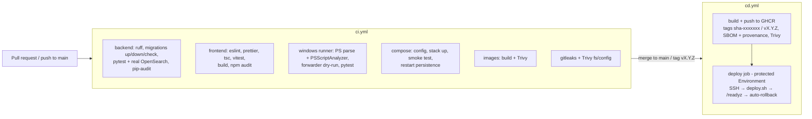

# DevOps: CI/CD, images, GitHub setup, releases and rollback



## Workflows

| File | Trigger | What it does |
|---|---|---|
| `.github/workflows/ci.yml` | PRs, pushes to `main` | 7 independent jobs listed above. Every step fails the job on failure; there is no `continue-on-error` on a required check (the only one is the Windows host-script probe, explained below) |
| `.github/workflows/cd.yml` | push to `main`, tags `v*`, manual dispatch | Publishes `ghcr.io/<owner>/<repo>-backend` and `-frontend` with `sha-<7 chars>` (main) or the git tag (releases); scans the image; deploys on tags or manual dispatch to a GitHub Environment. **Never uses `latest`** |
| `.github/dependabot.yml` | weekly | pip, npm, Actions, Docker updates |

The `windows` CI job runs on a real `windows-2022` runner: it parses and lints every PowerShell script, dry-runs the event
forwarder against the runner's Application log and runs the backend test-suite on Windows. Windows runners cannot run Linux
containers, so the Docker-based Windows checks (`Test-WindowsHost.ps1`) are informational there (`continue-on-error`);
full Windows + Docker Desktop validation is the manual procedure in DEPLOYMENT.md (executed on the author's Windows 11 host).

> **Status:** the workflows were written and statically reviewed but **have not been executed on GitHub** (this working copy has
> no remote). The commands they run (ruff, pytest, alembic, npm scripts, compose up + smoke, Trivy, pip-audit, npm audit)
> were executed locally; see TASKS.md for results. Expect to fix small environment differences on first run.

## One-time GitHub configuration

1. **Repository → Settings → Actions → General**: workflow permissions "Read repository contents"; allow GitHub Actions to create PRs only if you want Dependabot auto-merge.
2. **GHCR publishing**: nothing to configure — the CD job uses the ephemeral `GITHUB_TOKEN` with `packages: write`. After the first push, set the packages' visibility (Packages → Package settings) and, for private packages, create a **read-only PAT (`read:packages`)** for the server and store it as secret `GHCR_PULL_TOKEN`.
3. **Environments** (Settings → Environments): create `staging` and `production`. On `production` add **required reviewers** and restrict to the `main` branch/`v*` tags. Add to each Environment:
   * secrets: `DEPLOY_HOST`, `DEPLOY_USER`, `DEPLOY_SSH_KEY` (private key of a deploy-only user), `GHCR_PULL_TOKEN`;
   * variables (optional): `DEPLOY_PATH` (default `/opt/siem`), `DEPLOY_HEALTH_URL` (default `http://127.0.0.1:8080/readyz`, evaluated on the server).
   If the secrets are absent the deploy job **skips with a warning** — it never pretends to deploy.
4. **Branch protection** on `main`: require pull requests, require status checks `Backend (lint, tests, OpenSearch integration)`, `Frontend (lint, tests, build)`, `Windows runner (PowerShell + backend tests)`, `Compose config + stack smoke test`, `Build images + Trivy scan`, `Secret scan (gitleaks)`, `Trivy filesystem + config scan`; require up-to-date branches; disallow force pushes.
5. Target server: Docker + Compose plugin, a deploy user in the `docker` group, `/opt/siem/.env` with production values (never in the repo), outbound access to `ghcr.io`.

## Releases

```bash
git tag -a v1.0.0 -m "Release 1.0.0" && git push origin v1.0.0
```
The tag build publishes `…-backend:v1.0.0` / `…-frontend:v1.0.0`; the deploy job waits for Environment approval, runs
`deploy.sh v1.0.0` on the server, polls `/readyz` for up to 5 minutes and fails the job if the stack is unhealthy.

## Rollback

* **Automatic:** `deploy.sh` remembers the last healthy version (`.deployed_version`) and redeploys it if the new version is unhealthy (the job still fails so the problem is visible).
* **Manual / later:** Actions → *CD* → *Run workflow* → set `version` to a previously published tag (for example `sha-1a2b3c4` or `v0.9.2`) and the Environment. With `version` set the pipeline skips the build and deploys that exact image. Or on the server: `./deploy.sh <old-version>`.
* **Database:** migrations are forward-only in production. Rolling the application back across a schema change requires either a backward-compatible migration (the project's rule: additive first, destructive later) or a restore from backup (DEPLOYMENT.md §7). Alembic `downgrade` is tested in CI but should be your last resort.

## Local equivalents

```powershell
.\scripts\siem.ps1 test      # ruff (check+format), pytest, eslint, prettier, vitest
.\scripts\siem.ps1 up ; .\scripts\siem.ps1 smoke
```

## Version decisions

* Python 3.12, FastAPI + Pydantic v2, SQLAlchemy 2.x, Alembic, `argon2-cffi`, `PyJWT`, `opensearch-py`, `reportlab`, `prometheus-client` — runtime versions pinned exactly in `backend/requirements.txt` (generated from `requirements.in`).
* Node 22, React 18.3, Vite, Vitest, Tailwind CSS 4, Recharts 2, React Router 7 — exact versions in `package-lock.json` (`npm ci`).
* PostgreSQL 16.4, OpenSearch 2.17.1, Fluent Bit 3.1.9, Prometheus 2.54.1, Grafana 11.2.0, Nginx-unprivileged 1.27 (base images pinned by tag; pin by digest in regulated environments).
* React 18 is kept deliberately because Recharts 2 targets it; the pinned set was audited (0 known vulnerabilities at the time of writing).
